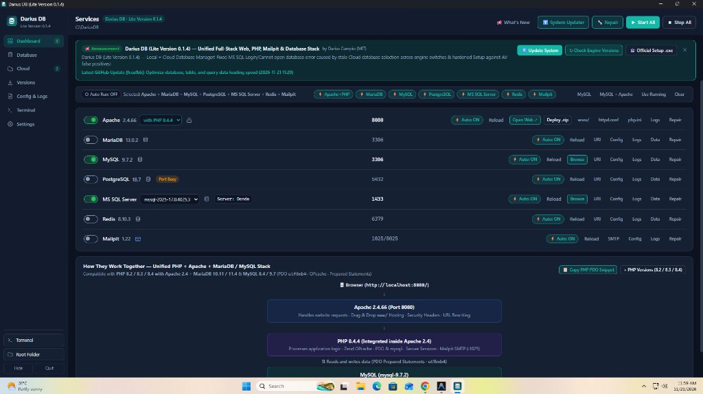
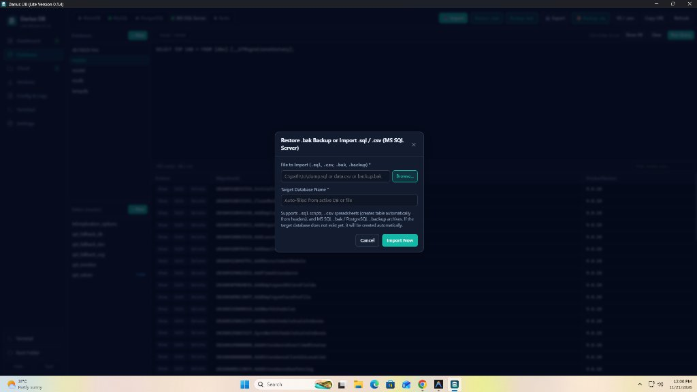
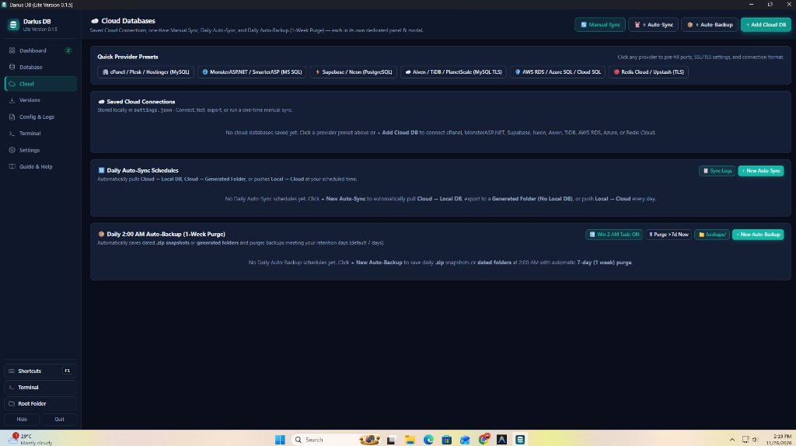
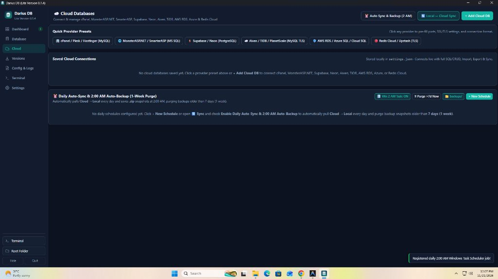
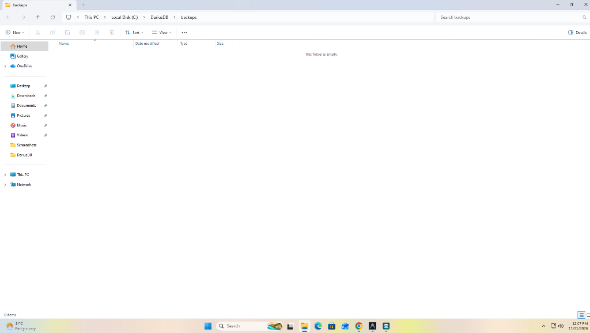
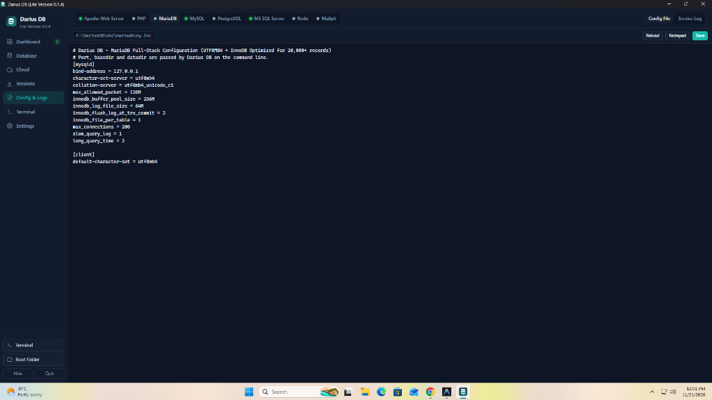
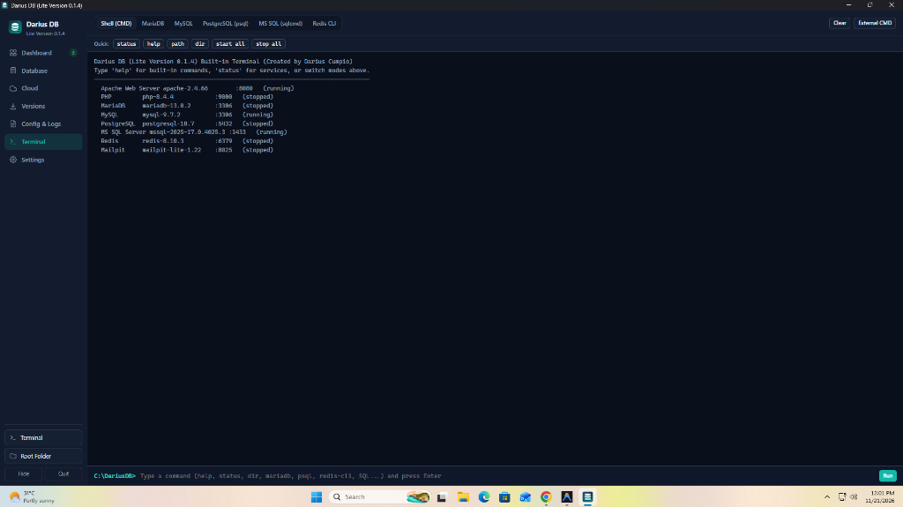

# Darius DB (Lite Version 0.1.4)

A fast, lightweight, portable open-source database environment manager for Windows — built to make local database development simple, clean, and zero-bloat.

Manage **Apache Web Server**, **MariaDB**, **MySQL**, **PostgreSQL**, **MS SQL Server**, and **Redis** from a single ~13 MB native Windows app with a system tray icon, local `www/` website hosting, built-in multi-mode terminal, native launcher, clean uninstaller, and zero runtime bloat.

- **Repository:** [https://github.com/dcquijano/Darius-DB-Lite-Version](https://github.com/dcquijano/Darius-DB-Lite-Version)
- 📥 **Official Installer & Portable Download (Google Drive):** [**Download DariusDB-Setup-0.1.4.exe**](https://drive.google.com/drive/folders/1FVLCHqOfxmP9PbSx70jy_BfH2Yn1E_UG?usp=sharing)
- 🖼️ **System Screenshots & Examples:** [**example/**](example/)
- 📖 **Full Step-by-Step Guide:** [**GUIDE.md**](GUIDE.md)

---

## System Preview ([`example/`](example/))

### Services Dashboard, Auto-Run Bar & Repair Diagnostics


| Auto-Run Toggle & Per-Service Pills | Self-Healing Repair & Diagnostics |
|---|---|
|  |  |

### Database Manager, SQL Browser & Row CRUD


| Show Row Details | Edit Row | Create Row |
|---|---|---|
|  |  |  |

### Export, Full `.zip` Backup & Multi-Format Import / `.bak` Restore
| Export (`.sql` / `.csv`) | Full `.zip` Backup | Import (`.sql` / `.csv` / `.bak`) | Restore `.bak` (MS SQL) |
|---|---|---|---|
|  |  |  |  |

### Cloud Databases & 2:00 AM Auto-Sync / Backup
| Cloud Databases & Daily Scheduler | Add Cloud DB (URI / ADO.NET Parse) | New 2:00 AM Auto-Sync & Backup |
|---|---|---|
|  |  |  |

| Windows 2:00 AM Scheduled Task | 7-Day Snapshot Purge | `backups/` Snapshot Folder |
|---|---|---|
|  |  |  |

### Versions Manager, Config & Logs, and Built-in Terminal
| Portable Engine Versions | Config & Logs Editor | Built-in Multi-Mode Terminal |
|---|---|---|
|  |  |  |

### Settings & GitHub System Version Updater
| Settings | GitHub System Updater |
|---|---|
|  |  |

---

## Features

- **100% Portable or Standard `.exe` Install** — Run directly out of any folder (`www/`, `bin/`, `data/`, `etc/`, `logs/`, `tmp/`, `settings.json`) or install using the standalone Windows Setup Wizard **`DariusDB-Setup-0.1.4.exe`** (with automatic double-installation protection and built-in **Repair Mode**).
- **Apache Web Server with Drag & Drop Website Hosting (`www/`)** — Host local websites at `http://localhost:8080/` and drag & drop project folders, `.zip` bundles, or `.html` files directly onto the browser dashboard (or click **`Deploy .zip`** on the Apache card).
- **One-Click Start/Stop & Native System Tray** — Start All / Stop All, per-engine controls, live PID & port-conflict detection, single-instance wake, close-to-tray, and right-click tray menu.
- **Database Restore & Backup (`.bak` & `.sql`)** — Restore MS SQL Server `.bak` files (with automatic `RESTORE FILELISTONLY` logical-file relocation into `data/mssql/`), import `.sql` scripts into MariaDB, MySQL, PostgreSQL, or MS SQL Server, and export `.bak` / `.sql` backups in one click or via CLI (`darius restore` / `darius backup`).
- **Self-Healing Repair & Diagnostics (`🔧 Repair` & `darius repair`)** — Automatically diagnoses and fixes missing portable directories, `www/index.html`, corrupted `settings.json`, engine configs (`etc/*`), stale crash locks (PostgreSQL `postmaster.pid`, `tmp/run/*.pid`), and SQL Server `MSSQLLocalDB` instances while keeping your databases in `data/` safe.
- **Portable Engine Downloader & Live Upstream Version Checker** — Click **↻ Check Newest Versions** to discover the latest MariaDB, PostgreSQL, and Redis builds live, update in one click (`↑ Update to <version>`), download `.zip` archives manually, or import any custom `.zip`.
- **Built-in Lightweight Database Browser**
  - **SQL (MariaDB / MySQL / PostgreSQL / MS SQL Server):** browse databases & tables, quick-create database + user/login with privileges, drop databases, run SQL / T-SQL (`Ctrl+Enter`), copy connection strings.
  - **Redis:** switch logical DBs (`db0`–`db15`), scan & filter keys, inspect values (with automatic JSON formatting & TTL), delete keys, and run interactive Redis CLI commands.
- **Config Editor & Live Log Viewer** — Edit `httpd.conf`, `my.ini`, `postgresql.conf`, `mssql.conf`, and `redis.conf` inside the app (or Notepad) with *Save & Restart*, plus auto-refreshing logs.
- **Native Launcher, Standalone Updater & 3-Step Win32 Uninstall Wizard**
  - `DariusDB-Setup-0.1.4.exe` — self-contained 4-step Windows Setup Wizard with automatic in-place upgrade detection (e.g. `0.1.3 → 0.1.4`) and Repair Mode.
  - `DariusDB-Launcher.exe` — verifies WebView2, sets `DARIUSDB_HOME`, supports `--minimized`, `--terminal`, `--start-all`, `--stop-all`, `--version`.
  - `DariusDB-Updater.exe` — native Win32 System Version Updater GUI & CLI (`--check`, `--silent`, `--token=PAT`) that detects installed version, checks GitHub (`version.json` + Releases + Commits) and local installers, and upgrades in-place while keeping `data/` and `www/` untouched.
  - `DariusDB-Uninstall.exe` — native 3-step Win32 wizard with **Uninstall** and **Repair** modes, live progress bar, scrolling log, and safe database preservation (`data/`, `www/`, `etc/`).
- **Developer CLI (`darius.exe`) for Visual Studio, VS Code & Terminals** — Automatically added to your Windows `PATH` (`C:\DariusDB`). Run `darius status`, `darius start all`, `darius repair`, `darius restore`, `darius backup`, `darius env mssql MyApp`, `darius sql mssql "SELECT @@VERSION"`, `darius createdb`, `darius versions`, `darius update`, and `darius install` from any IDE or terminal.
- **Pre-configured Multi-Mode Terminal** — Switch between Windows Shell, MariaDB, MySQL, PostgreSQL (`psql`), MS SQL (`sqlcmd`), and Redis CLI inside the app.
- **Built-in Step-by-Step Guide & Keyboard Shortcuts (`Alt+8` / `F1`)** — Interactive quick-start checklist, collapsible step-by-step manual, searchable keyboard shortcuts popup (`F1` / `Ctrl+/` / `?`), global navigation (`Alt+1`–`Alt+8`), service controls (`Ctrl+Shift+S` / `X` / `R` / `A` / `U`), SQL tab/query hotkeys, and one-click CLI copy reference.

---

## Quick Start

### Option 1: Install on Windows (Recommended)
1. Download **`DariusDB-Setup-0.1.4.exe`** from the [**Official Google Drive Installer Folder**](https://drive.google.com/drive/folders/1FVLCHqOfxmP9PbSx70jy_BfH2Yn1E_UG?usp=sharing) (or run local build output `installer\DariusDB-Setup-0.1.4.exe` / `dist\DariusDB-Setup-0.1.4.exe`).
2. Double-click **`DariusDB-Setup-0.1.4.exe`**, choose **`C:\DariusDB`** (default), and complete the 3-step Setup Wizard.
3. Launch **Darius DB (Lite Version 0.1.4)** from the Desktop or Start Menu.
4. Open **Versions** to download MariaDB, MySQL, PostgreSQL, or Redis (or start **Apache Web Server** and **MS SQL Server** immediately), then click **Start All**.

### Option 2: Portable (No Install)
1. Download `DariusDB-0.1.4-portable-windows-amd64.zip` from [**Google Drive**](https://drive.google.com/drive/folders/1FVLCHqOfxmP9PbSx70jy_BfH2Yn1E_UG?usp=sharing) (or `dist\DariusDB-0.1.4-portable-windows-amd64.zip`) and extract into any folder, e.g. `C:\DariusDB\`.
2. Double-click `DariusDB-Launcher.exe` (or `DariusDB.exe`).

---

## Portable Folder Structure

```text
C:\DariusDB\
├── DariusDB.exe
├── DariusDB-Launcher.exe
├── DariusDB-Uninstall.exe
├── DariusDB-Updater.exe
├── darius.exe
├── settings.json
├── GUIDE.md
├── README.md
├── LICENSE
├── www/
│   ├── index.html
│   └── my-website/
├── bin/
│   ├── apache/apache-2.4.66/
│   ├── mariadb/mariadb-13.0.2/
│   ├── mysql/mysql-9.7.2/
│   ├── postgresql/postgresql-18.7/
│   ├── mssql/mssql-17.0.1000.7/
│   └── redis/redis-8.10.3/
├── data/
│   ├── mariadb-13.0/
│   ├── mysql-9.7/
│   ├── postgresql-18/
│   ├── mssql/
│   └── redis/
├── etc/
│   ├── apache/httpd.conf
│   ├── mariadb/my.ini
│   ├── mysql/my.ini
│   ├── mssql/mssql.conf
│   └── redis/redis.conf
├── logs/
│   ├── apache.log
│   ├── mariadb.log
│   ├── mysql.log
│   ├── postgresql.log
│   ├── mssql.log
│   └── redis.log
└── tmp/
```

---

## Supported Database & Web Engines

| Engine | Default Port | Included Versions |
|---|---|---|
| **Apache Web Server** | `8080` (`www/`) | `2.4.66` (Apache 2.4 Win64 VS17/VS18) + `apache-lite-2.4` (Built-in instant web server) |
| **MariaDB** | `3306` | `13.0.2` (Latest Stable), `12.3.4` (LTS), `11.8.10` (LTS), `11.4.14` (LTS), `10.11.20` (LTS) |
| **MySQL** | `3307` | `9.7.2` (Latest), `8.4.11` (LTS), `8.0.46` (LTS) |
| **PostgreSQL** | `5432` | `18.7` (Latest), `17.12`, `16.16`, `15.20`, `14.25` |
| **MS SQL Server** | `1433` / LocalDB | `17.0.1000.7` / `17.0.4025.3` (**SQL Server 2025 — 17.x**), `16.0.1000.6` (SQL Server 2022 — 16.x) |
| **Redis** | `6379` | `8.10.3` (Latest), `8.8.3`, `7.4.11` (LTS), `6.2.24`, `5.0.14.1` |

---

## Building from Source & Packaging the Installer

### Prerequisites
- Windows 10/11 (x64) with Microsoft Edge WebView2 (pre-installed on Windows 10/11)
- [Go 1.24+](https://go.dev/dl/)
- [Wails CLI v2](https://wails.io/): `go install github.com/wailsapp/wails/v2/cmd/wails@latest`
- *(Optional, for `DariusDB-Setup-0.1.4.exe`)* [Inno Setup 6](https://jrsoftware.org/isinfo.php): `winget install JRSoftware.InnoSetup`

No C compiler (CGO) and no Node.js build step required!

### Build Everything (App + Launcher + Uninstaller + Portable ZIP + Setup EXE)

```powershell
powershell -ExecutionPolicy Bypass -File installer\build-all.ps1
```

Or build only the main GUI app:

```powershell
go test ./...
wails build -clean -ldflags "-s -w"
```

---

## Credits & Information

| | |
|---|---|
| **Application** | **Darius DB (Lite Version 0.1.4)** |
| **Creator / Author** | **Darius Cumpio** |
| **Built By** | Darius Cumpio |
| **Created Date** | November 19, 2026 |
| **Year** | 2026 |
| **Version** | `Lite Version 0.1.4` |
| **Repository** | [https://github.com/dcquijano/Darius-DB-Lite-Version](https://github.com/dcquijano/Darius-DB-Lite-Version) |
| **Installer Download** | [https://drive.google.com/drive/folders/1FVLCHqOfxmP9PbSx70jy_BfH2Yn1E_UG?usp=sharing](https://drive.google.com/drive/folders/1FVLCHqOfxmP9PbSx70jy_BfH2Yn1E_UG?usp=sharing) |
| **License** | [MIT License](LICENSE) — Copyright © 2026 Darius Cumpio |
