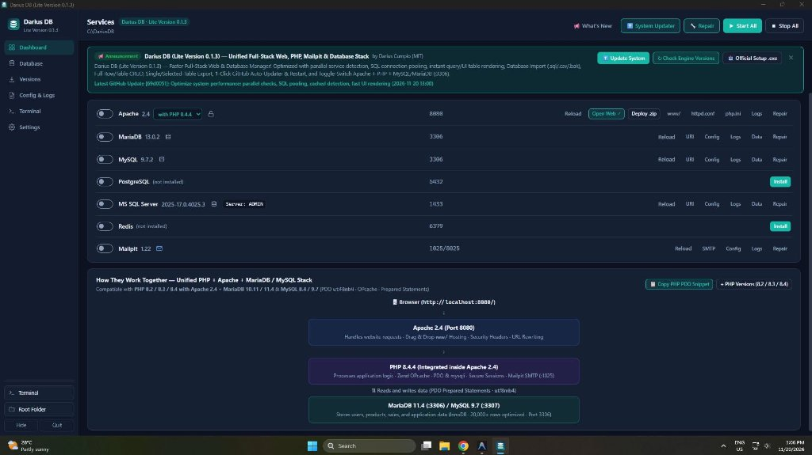
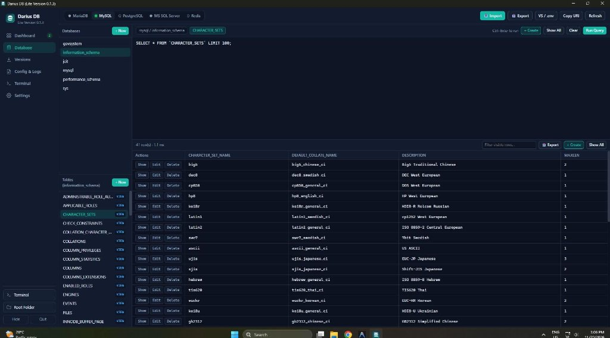
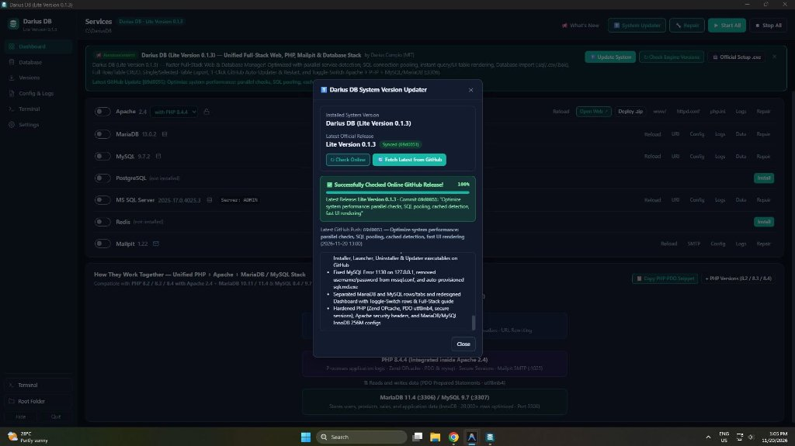

# Darius DB (Lite Version 0.1.3) — System Examples & Screenshots

Visual showcase of **Darius DB (Lite Version 0.1.3)** running on Windows.

---

## 1. Unified Services Dashboard & PHP / Apache / DB Stack

Manage **Apache 2.4**, **PHP (8.2 / 8.3 / 8.4)**, **MariaDB**, **MySQL**, **PostgreSQL**, **MS SQL Server 2025**, **Redis**, and **Mailpit** with one-click toggle switches, quick config/log/data shortcuts, announcement banner, and the live **Unified Full-Stack Diagram**.

---

## 2. Database Manager, SQL Browser & Full CRUD

Browse databases and tables across **MariaDB**, **MySQL**, **PostgreSQL**, **MS SQL Server**, and **Redis** with `.sql` / `.csv` / `.bak` **Import**, single/selected-table or full-database **Export**, inline **Show / Edit / Delete / + Create** row CRUD, and fast **Show All** table rendering (`1.1 ms` query speed).

---

## 3. Live GitHub System Version Updater

Check online for new versions/builds, sync release announcements and commit history directly from GitHub, and perform 1-click in-place upgrades with automatic restart (`data/` and `www/` preserved).

