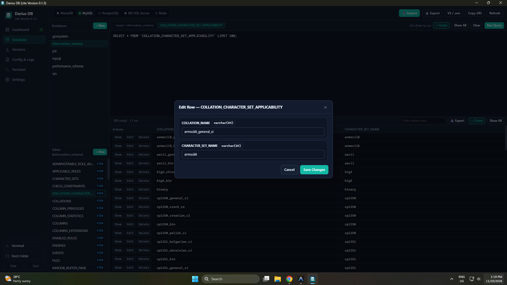
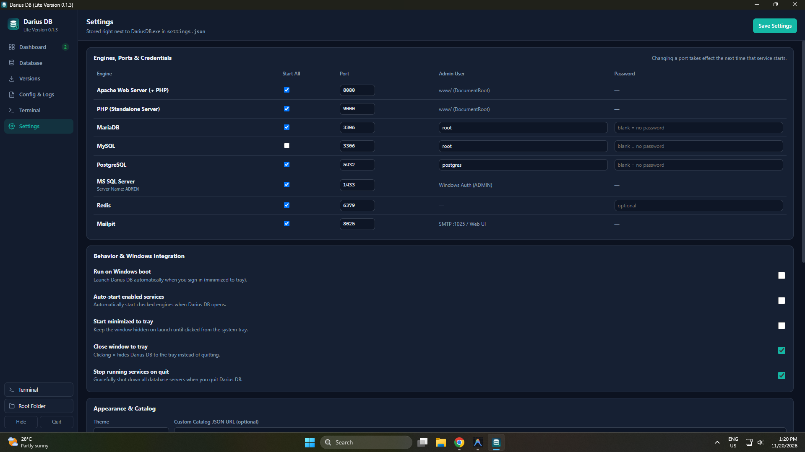

# Darius DB (Lite Version 0.1.4) — System Examples & Screenshots

Visual showcase of **Darius DB (Lite Version 0.1.4)** in action on Windows.

---

## 1. Unified Services Dashboard & PHP / Apache / DB Stack

Manage **Apache 2.4**, **PHP (8.2 / 8.3 / 8.4)**, **MariaDB**, **MySQL**, **PostgreSQL**, **MS SQL Server 2025**, **Redis**, and **Mailpit** with one-click toggle switches, Auto-Run service presets, quick config/log/data shortcuts, live GitHub update announcements, and the **Unified Full-Stack Diagram**.

---

## 2. Database Manager & Fast SQL Browser

Browse databases and tables across **MariaDB**, **MySQL**, **PostgreSQL**, **MS SQL Server** (local & Cloud), and **Redis** with live database/table counts, resizable & collapsible split panes, stretchable result columns, fast non-blocking loading, inline filtering, and full table/row actions.

---

## 3. Row CRUD (Show, Edit & Create)

### Show Row Details (with Field Copy & Copy JSON)

### Edit Row

### Create New Row

---

## 4. Database Export, Full `.zip` Backup & Import / Restore

### Export (Entire Database, Single Table, or Selected Tables as `.sql`, `.zip`, or `.csv`)

### Full Database `.zip` Backup (SQL Dump + Table CSVs + `manifest.json`)

### Import (`.sql`, `.csv`, `.bak`, `.backup`)

### Restore `.bak` Backup or Import `.sql` / `.csv` (MS SQL Server)

---

## 5. Settings (Ports, Credentials & Windows Integration)

Configure ports, default database credentials, Start All selection, close-to-tray behavior, and auto-start options saved cleanly to `settings.json`.

---

## 6. Live GitHub System Version Updater

Check online for new versions/builds, sync release announcements and commit history directly from GitHub, and perform 1-click in-place upgrades with automatic restart (`data/` and `www/` preserved).

